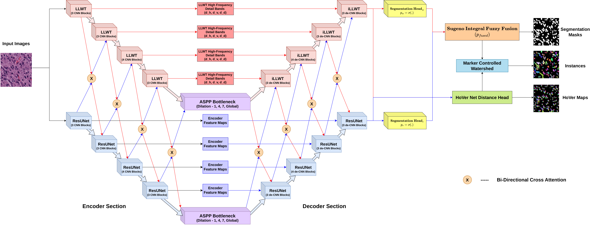
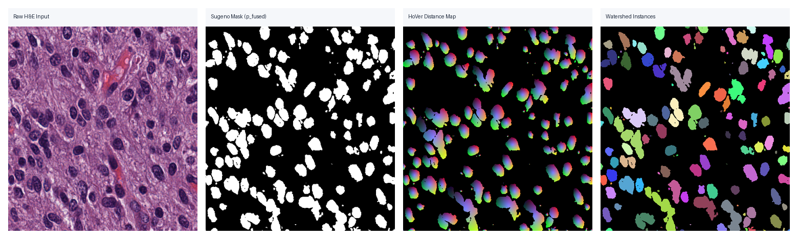
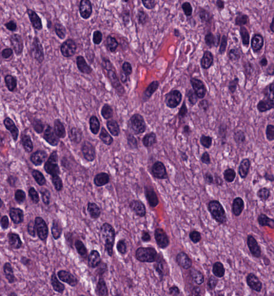
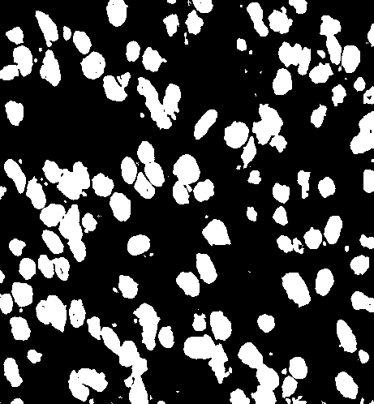
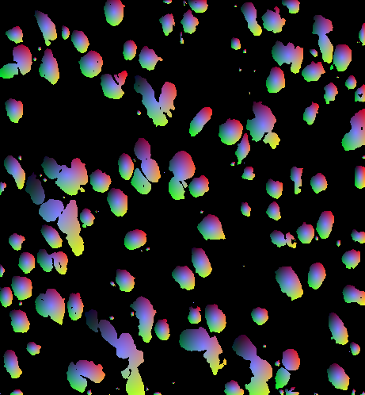
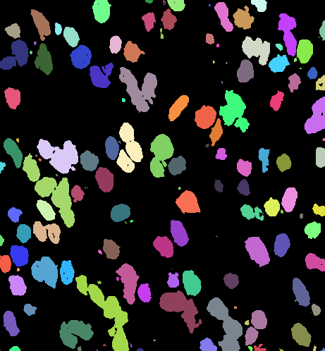

<div align="center">

# **A Dual-Branch Wavelet-ResNet Model with Cross-Attention and Sugeno Fuzzy Fusion for Nuclear Instance Segmentation**

### **IEEE International Symposium on Biomedical Imaging (IEEE ISBI)**
#### **Under Review &bull; IEEE Signal Processing Society &bull; IEEE Engineering in Medicine and Biology Society**

</div>

<p align="center">
  <a href="https://biomedicalimaging.org/"></a>
  <a href="https://biomedicalimaging.org/"></a>
  <a href="https://signalprocessingsociety.org/"></a>
  <a href="LICENSE"></a>
  <a href="https://pytorch.org/"></a>
  <a href="https://www.python.org/"></a>
  <a href="https://developer.nvidia.com/cuda-toolkit"></a>
</p>

Official documentation and technical reference for **"A Dual-Branch Wavelet-ResNet Model with Cross-Attention and Fuzzy Fusion for Nuclear Segmentation and Instance Segmentation in Histopathology Images"**, submitted to the **[IEEE International Symposium on Biomedical Imaging (IEEE ISBI)](https://biomedicalimaging.org/)**.

**Authors:** Diptarko Bhattacharjee, Mukut Chatterjee, Dmitrij Kaplun<sup>✉</sup>, Ram Sarkar  
<sup>✉</sup> Corresponding author: [dikaplun@etu.ru](mailto:dikaplun@etu.ru)  
**Conference Portal:** [biomedicalimaging.org](https://biomedicalimaging.org/)

---

## Overview

Accurate instance segmentation of cell nuclei in routine hematoxylin and eosin (H&E) histopathology images is foundational for computational pathology workflows, guiding tumor grading, cellular pleomorphism quantification, and spatial micro-environment profiling. In high-grade malignant neoplasms, delineation is heavily compromised by tightly clustered nuclei, indistinct chromatin boundaries, and severe chromatic variability across laboratories.

Conventional convolutional networks (such as U-Net) rely on aggressive spatial downsampling via strided convolutions or max-pooling, which permanently eradicates high-frequency sub-band details and leads to under-segmentation along abutting membranes. While multi-task architectures like HoVer-Net regress distance-to-centroid fields, their intermediate pooling layers still suffer spatial aliasing. Vision transformers capture global dependencies but incur quadratic token costs while blurring sub-pixel cellular perimeters.

This framework couples multi-frequency wavelet analysis with deep residual representations through a symmetric dual-stream architecture:
- **Learnable Lifting Wavelet Transform (LLWT) Stream:** Decomposes features into multi-directional high-frequency detail sub-bands ($d_h, d_v, d_d$) via an algebraically invertible 2D lifting scheme with stain-adaptive spatial calibration, completely bypassing pooling loss and routing edge primitives directly to an Inverse LLWT decoder.
- **Residual Context Stream with GeM Pooling:** Extracts deep histological abstractions via pre-activation ResBlocks and learnable Generalized Mean ($f_{\mathrm{GeM}}$) pooling, dynamically interpolating between average and max operations.
- **Multi-Scale Bi-Directional Cross-Attention (BiCA):** Exchanges contextual and geometric cues in channel-covariance space across stages, utilizing zero-initialized Batch Normalization ($\gamma_{\mathrm{init}} = 0, \beta_{\mathrm{init}} = 0$) to preserve pre-trained feature stability during early training.
- **Skip-Connection Feature Alignment:** Supervised via channel-normalized Mean Squared Error ($\mathcal{L}_{\mathrm{feat}}$), enforcing cosine similarity between upsampled decoder representations and encoder skip features to eliminate latent subspace divergence.
- **Learnable Sugeno Fuzzy Integral Decision Fusion:** Dynamically arbitrates between stream probabilities pixel-by-pixel using learned singleton fuzzy densities ($g_1, g_2$), resolving boundary ambiguities through non-additive fuzzy measures.
- **Multi-Task HoVer Head & Marker Watershed:** Regresses continuous horizontal and vertical distance-to-centroid vectors, yielding topological distance surfaces whose gradient basins drive marker-controlled watershed flooding.

---

## Model Architecture

<p align="center">
  
</p>

*Figure 1: Comprehensive architectural blueprint of the Dual-Branch Wavelet-ResNet network. The LLWT encoder decomposes features into low-frequency approximations and directional detail sub-bands, which bypass deep abstractions directly to the Inverse LLWT decoder. Multi-scale Bi-Directional Cross-Attention (BiCA) synchronizes representations across both streams. Fused intermediate features feed dual heads for Sugeno semantic segmentation and HoVer distance regression, driving marker-controlled watershed instance decoding.*

### Structural Breakdown

| Stage / Component | Spatial Size | Channels (Wavelet / ResNet) | Primary Operations & Functional Description |
|:---|:---:|:---:|:---|
| **Input Tile** | $256 \times 256$ | 3 | Native-resolution 3-channel H&E histology image patch |
| **Stage 1 (E1 / D1)** | $128 \times 128$ | 128 / 64 | Polyphase LLWT splitting $\leftrightarrow$ BiCA-1 $\leftrightarrow$ ResNet Stem + GeM Downsampling |
| **Stage 2 (E2 / D2)** | $64 \times 64$ | 256 / 128 | Directional Predict/Update $\leftrightarrow$ BiCA-2 $\leftrightarrow$ PreAct ResBlocks; Auxiliary Head on D2 |
| **Stage 3 (E3 / D3)** | $32 \times 32$ | 512 / 256 | Multi-frequency Decomposition $\leftrightarrow$ BiCA-3 $\leftrightarrow$ Contextual ResBlocks; Auxiliary Head on D3 |
| **Stage 4 (E4 / D4)** | $16 \times 16$ | 512 / 512 | Deep Feature Extraction $\leftrightarrow$ BiCA-4 $\leftrightarrow$ Deep Semantic Subspace Alignment ($\mathcal{L}_{\mathrm{feat}}$) |
| **Bottleneck** | $16 \times 16$ | 512 / 512 | Dual ASPP Bottlenecks (Dilation Rates: 1, 4, 7, Global Pooling) with 2D Spatial Dropout |
| **Heads & Fusion** | $256 \times 256$ | 1 (Seg) / 2 (HV) | Sugeno Fuzzy Integral ($p_{\mathrm{fused}}$) $\rightarrow$ Mask; HoVer Head ($[-1, 1]^2$ Maps) $\rightarrow$ Watershed |

---

## Quantitative Benchmarks

The framework was evaluated across three public histopathology benchmarks: **MoNuSeg** (Multi-Organ Nuclei Segmentation, 7 organs), **TNBC** (Triple Negative Breast Cancer, pleomorphic malignant carcinoma), and **CPM-15** (Computational Pathology Challenge, glioblastoma, lung, and head/neck carcinoma). Performance is quantified via semantic overlap (**Dice**) and instance-level separation metrics (**Aggregated Jaccard Index [AJI]** and **Panoptic Quality [PQ]**).

### Performance Summary (Scores in %)

| Benchmark Dataset | Evaluation Metric | Prior State-of-the-Art (Trans-UNet) | DualBranchNet (Ours) | Relative Margin |
|:---|:---:|:---:|:---:|:---:|
| **MoNuSeg** | Dice / AJI / PQ | 81.01 / 57.31 / 56.88 | **82.46 / 62.44 / 61.49** | **+1.45 / +5.13 / +4.61** |
| **TNBC** | Dice / AJI / PQ | 86.78 / 63.15 / 65.16 | **88.00 / 70.23 / 69.69** | **+1.22 / +7.08 / +4.53** |
| **CPM-15** | Dice / AJI / PQ | 88.45 / 68.78 / 63.17 | **90.02 / 70.82 / 67.40** | **+1.57 / +2.04 / +4.23** |

<details>
<summary><b>View complete comparative baselines across published architectures</b></summary>

| Method | Benchmark Architecture Type | MoNuSeg (Dice / AJI / PQ) | TNBC (Dice / AJI / PQ) | CPM-15 (Dice / AJI / PQ) |
|:---|:---|:---:|:---:|:---:|
| BoNuS (2023) | Boundary-Oriented CNN | -- / -- / -- | 76.73 / 60.73 / -- | 79.99 / 54.54 / -- |
| Swin-UNet (2022) | Hierarchical Vision Transformer | 80.12 / 53.12 / 54.87 | 84.71 / 61.46 / 63.12 | 86.92 / 65.79 / 61.28 |
| DELTASEG (2023) | Differential Boundary Network | 81.42 / -- / -- | 82.95 / -- / -- | -- / -- / -- |
| Trans-UNet (2021) | Hybrid CNN-Transformer | 81.01 / 57.31 / 56.88 | 86.78 / 63.15 / 65.16 | 88.45 / 68.78 / 63.17 |
| U$^2$-Net (2020) | Nested U-Structure | 80.92 / 56.72 / 56.02 | 85.92 / 62.01 / 62.58 | 87.78 / 67.34 / 62.39 |
| **DualBranchNet (Ours)** | **Wavelet-ResNet Fuzzy Hybrid** | **82.46 / 62.44 / 61.49** | **88.00 / 70.23 / 69.69** | **90.02 / 70.82 / 67.40** |

</details>

---

## Detailed Visualization Pipeline

<p align="center">
  
</p>

*Figure 2: End-to-end qualitative prediction pipeline generated by DualBranchNet. From left to right: (a) Native-resolution H&E input patch, (b) Continuous foreground probability map $p_{\mathrm{fused}}$ produced by Sugeno fuzzy integral fusion, (c) Normalized HoVer distance surface showing steep centroid-directed gradients, and (d) Marker-controlled watershed instance segmentation cleanly separating adjacent nuclear boundaries.*

### Comprehensive Multi-Stage Visual Breakdown

| Stage (a): Raw H&E Input Tile | Stage (b): Sugeno Mask ($p_{\mathrm{fused}}$) | Stage (c): HoVer Distance Map | Stage (d): Watershed Instances |
|:---:|:---:|:---:|:---:|
|  |  |  |  |
| Multi-organ histology crop with dense cellular crowding and chromatin heterogeneity | High-fidelity foreground probability arbitrated pixel-wise via singleton fuzzy densities ($g_1, g_2$) | Continuous horizontal/vertical offset fields with distinct sign reversals across borders | Individual nuclear entities resolved into distinct labels via topological gradient basins |

### Detailed Analysis of Diagnostic Maps

1. **Raw H&E Input Tile (Stage a):** Captures high-grade tissue sections characterized by hyperchromatic nuclear pleomorphism, syncytial clusters, and variable eosinophilic background stroma. Abutting nuclei exhibit narrow, low-contrast clefts that cause standard thresholding to fail.
2. **Sugeno Fused Segmentation Mask (Stage b):** The learnable fuzzy integral dynamically routes confidence between streams:
   - In smooth nuclear interiors, deep semantic features from the ResNet stream dominate ($p_r$).
   - Along high-frequency nuclear perimeters, the preserved LLWT detail sub-bands ($d_h, d_v, d_d$) dominate ($p_w$).
   - Disagreements are arbitrated via the learned fuzzy densities ($g_1, g_2$), preventing boundary erosion and suppressing stromal false positives.
3. **HoVer Distance Map (Stage c):** Regresses continuous distance-to-centroid vectors normalized to $[-1, 1]$. Pixels on opposite sides of a nuclear centroid exhibit opposite mathematical signs, creating sharp gradient discontinuities along touching cell boundaries while remaining zero at nuclear centers.
4. **Marker-Controlled Watershed Instances (Stage d):** The Sobel gradient magnitude of the distance map $\tilde{\mathbf{G}} = \max(|\nabla \hat{\mathbf{H}}|, |\nabla \hat{\mathbf{V}}|)$ creates deep topographic basins at nuclear centroids. Seed markers extracted from low-gradient foreground regions are flooded across the energy landscape, cleanly cleaving touching nuclei without over-segmentation.

---

## Ablation Studies and Analysis

Systematic modular ablations validate the mathematical contribution of each architectural block:

1. **Learnable Directional Lifting Preserves Fine Boundaries (+5.41% AJI on MoNuSeg):** Replacing fixed Haar wavelets with our learnable directional predict/update filters yields substantial gains (+3.48% Dice, +5.41% AJI on MoNuSeg). This confirms that learning spatial orientation vectors preserves sub-pixel nuclear margins that are permanently erased by conventional pooling.
2. **Sugeno Fuzzy Fusion Arbitrates Source Reliability (+2.32% AJI over Standard Sugeno, +3.23% over Concatenation):** Fusing branch probabilities via learned singleton densities ($g_1, g_2$) significantly outperforms linear averaging, concatenation, and gated attention. The fuzzy integral acts as an adaptive confidence gate, defaulting to the wavelet stream along sharp boundaries and the ResNet stream within homogeneous cell bodies.
3. **Skip Feature Alignment ($\mathcal{L}_{\mathrm{feat}}$) Prevents Representation Drift:** Directing transposed-convolution upsamplings to align with encoder skip features via normalized MSE maximizes cosine similarity, providing steady convergence gains (+1.55% Dice, +2.25% AJI on MoNuSeg).
4. **Mean Squared Gradient Error (MSGE) Enforces Steep Topographic Basins (+5.0 AJI Gain):** Supervising horizontal and vertical Sobel gradients across distance maps suppresses artifacts on the topological energy surface, preventing spurious over-segmentation during watershed flooding.

<details>
<summary><b>View official modular and loss ablation tables</b></summary>

### Modular Architecture Ablation (Scores in %)
| Component Under Test | Tested Configuration | MoNuSeg (Dice / AJI / PQ) | TNBC (Dice / AJI / PQ) | CPM-15 (Dice / AJI / PQ) |
|:---|:---|:---:|:---:|:---:|
| **ResUNet Backbone** | EfficientNet-B0 Block | 80.66 / 57.91 / 58.87 | 86.10 / 67.18 / 62.95 | 87.89 / 67.61 / 63.45 |
| | VGG-16 Block | 80.59 / 57.27 / 56.11 | 86.78 / 62.95 / 61.73 | 87.38 / 67.71 / 63.14 |
| | DenseNet-121 Block | 80.90 / 58.82 / 58.27 | 86.77 / 67.98 / 65.30 | 88.98 / 66.88 / 61.71 |
| | **ResBlock (Ours)** | **80.99 / 59.04 / 58.19** | **87.08 / 68.62 / 65.69** | **89.46 / 70.38 / 64.94** |
| **Wavelet Scheme** | Fixed Haar Wavelet | 80.52 / 60.95 / 58.96 | 86.09 / 61.36 / 61.97 | 88.30 / 67.58 / 65.81 |
| | Single Shared MLP Predict | 80.87 / 57.02 / 57.65 | 86.97 / 63.52 / 62.72 | 88.24 / 65.77 / 63.21 |
| | **Directional LLWT (Ours)** | **80.95 / 60.36 / 59.92** | **87.23 / 67.18 / 66.87** | **89.11 / 68.58 / 65.71** |
| **Decision Fusion** | Feature Concatenation | 80.78 / 59.21 / 58.93 | 84.62 / 62.01 / 62.91 | 85.70 / 67.45 / 64.34 |
| | Majority Voting | 80.41 / 58.75 / 57.21 | 85.45 / 61.97 / 63.02 | 87.34 / 67.62 / 62.03 |
| | Standard Fixed Sugeno | 81.56 / 60.12 / 59.78 | 87.01 / 63.00 / 64.72 | 88.98 / 69.31 / 63.49 |
| | **Learnable Sugeno (Ours)**| **82.46 / 62.44 / 61.49** | **88.00 / 70.23 / 69.69** | **90.02 / 70.82 / 67.40** |

### Composite Loss Objective Progression (Scores in %)
| $\mathcal{L}_{\mathrm{seg}}$ | $\mathcal{L}_{\mathrm{feat}}$ | $\mathcal{L}_{\mathrm{hv}}$ | $\mathcal{L}_{\mathrm{bnd}}$ | MoNuSeg (Dice / AJI / PQ) | TNBC (Dice / AJI / PQ) | CPM-15 (Dice / AJI / PQ) |
|:---:|:---:|:---:|:---:|:---:|:---:|:---:|
| ✓ | -- | -- | -- | 77.65 / 53.45 / 53.15 | 84.15 / 61.40 / 61.15 | 85.30 / 61.80 / 59.35 |
| ✓ | ✓ | -- | -- | 79.20 / 55.70 / 55.15 | 85.42 / 63.60 / 63.10 | 86.95 / 64.25 / 61.05 |
| ✓ | ✓ | ✓ | -- | 81.15 / 60.70 / 59.75 | 87.10 / 68.60 / 67.85 | 89.15 / 69.10 / 65.25 |
| ✓ | ✓ | ✓ | ✓ | **82.46 / 62.44 / 61.49** | **88.00 / 70.23 / 69.69** | **90.02 / 70.82 / 67.40** |

</details>

---

## Comprehensive Mathematical Methodology

### 1. Mathematical Formalization of Nuclear Instance Segmentation
Let $\mathbf{I} \in \mathbb{R}^{3 \times H \times W}$ denote an RGB histopathology image of spatial dimensions $H \times W$. The objective of semantic segmentation is to learn a binary mapping $\mathbf{M} \in \{0, 1\}^{H \times W}$, where $\mathbf{M}(y, x) = 1$ indicates nuclear presence and $\mathbf{M}(y, x) = 0$ denotes extracellular stroma:

$$\mathbf{M}(y, x) = \mathbb{I}\left( (y, x) \in \bigcup_{k=1}^{K} \Omega_k \right)$$

where $\Omega_k$ denotes the compact topological support of the $k$-th distinct cell nucleus, and $K$ represents the total nuclear count.

When two adjacent nuclei touch along their perimeter:

$$\partial \Omega_i \cap \partial \Omega_j \neq \emptyset$$

their union forms a single connected component in $\mathbf{M}$. Consequently, standard 8-connected component labeling merges both instances:

$$\mathrm{dist}(\Omega_i, \Omega_j) = 1 \implies \mathbf{Y}_{\mathrm{cc}}(\Omega_i) \equiv \mathbf{Y}_{\mathrm{cc}}(\Omega_j)$$

This leads to catastrophic under-segmentation. Nuclear instance segmentation resolves this by estimating a unique integer identification matrix:

$$\mathbf{Y}_{\mathrm{inst}} \in \mathbb{N}_0^{H \times W}$$

$$\mathbf{Y}_{\mathrm{inst}}(y, x) = \begin{cases} k, & \text{if } (y, x) \in \Omega_k \\ 0, & \text{if } (y, x) \in \text{background} \end{cases}$$

subject to the pairwise mutual exclusion constraint:

$$\Omega_i \cap \Omega_j = \emptyset, \quad \forall i \neq j$$

---

### 2. Learnable Lifting Wavelet Transform (LLWT) Stream
To circumvent the irreversible boundary blurring caused by max-pooling and strided convolutions, the wavelet stream decomposes spatial signals through a 2D second-generation lifting scheme.

#### Polyphase Lattice Decomposition (Split Step)
An incoming feature map $\mathbf{X} \in \mathbb{R}^{C \times H \times W}$ is partitioned into four non-overlapping sub-grids sampled on even and odd spatial coordinates:

$$
\begin{aligned}
x_{00}(c, i, j) &= \mathbf{X}(c, 2i, 2j)     && \text{(Reference Component - Even rows, Even cols)} \\
x_{01}(c, i, j) &= \mathbf{X}(c, 2i, 2j + 1) && \text{(Horizontal Component - Even rows, Odd cols)} \\
x_{10}(c, i, j) &= \mathbf{X}(c, 2i + 1, 2j) && \text{(Vertical Component - Odd rows, Even cols)} \\
x_{11}(c, i, j) &= \mathbf{X}(c, 2i + 1, 2j + 1) && \text{(Diagonal Component - Odd rows, Odd cols)}
\end{aligned}
$$

where each polyphase component has reduced spatial dimensions $\mathbb{R}^{C \times \frac{H}{2} \times \frac{W}{2}}$.

#### Stain-Adaptive Spatial Calibration (StainAdapt)
To account for chromatic variance across staining protocols, a global context descriptor $\mathbf{y}_{\mathrm{gap}} = \mathrm{GAP}(x_{00}) \in \mathbb{R}^{C \times 1 \times 1}$ is processed through a bottleneck multi-layer perceptron (reduction ratio $r = 4$):

$$\mathbf{s} = \sigma\Big(\mathbf{W}_2 \cdot \mathrm{ReLU}(\mathbf{W}_1 \mathbf{y}_{\mathrm{gap}} + \mathbf{b}_1) + \mathbf{b}_2\Big) \in \mathbb{R}^{C \times 1 \times 1}$$

The calibrated spatial representation is obtained via channel broadcasting:

$$S(x_{00}, f) = f \odot \mathbf{s}$$

#### Learnable Directional Predict Step
Three dedicated depthwise convolutional operators predict detail components from reference sub-grid $x_{00}$:

$$
\begin{aligned}
d_h &= x_{01} - S_h\big(x_{00}, \mathcal{P}_h(x_{00})\big) \\
d_v &= x_{10} - S_v\big(x_{00}, \mathcal{P}_v(x_{00})\big) \\
d_d &= x_{11} - S_d\big(x_{00}, \mathcal{P}_d(x_{00})\big)
\end{aligned}
$$

where:

$$\mathcal{P}_k(x) = \mathrm{PReLU}\Big(\mathrm{BN}\big(\mathrm{DWConv}_{3\times3}^{(k)}(x)\big)\Big), \quad k \in \{h, v, d\}$$

When a cellular boundary crosses the kernel support, $d_k$ captures the directional gradient discontinuity.

#### Learnable Directional Update Step
The coarse approximation $c_l$ is synthesized by incorporating detail sub-bands through update operators $\mathcal{U}_k$ and learnable scalars:

$$c_l = x_{00} + k_h \mathcal{U}_h(d_h) + k_v \mathcal{U}_v(d_v) + k_d \mathcal{U}_d(d_d)$$

The complete sub-band representation is projected via a $1\times1$ convolution:

$$\mathbf{X}_{\mathrm{subbands}} = [c_l \,\|\, d_h \,\|\, d_v \,\|\, d_d]$$

while the high-frequency detail sub-bands bypass the encoder directly to the decoder:

$$\mathbf{D} = [d_h \,\|\, d_v \,\|\, d_d]$$

#### Exact Mathematical Invertibility (Theorem 1)
Because the lifting equations form a lower-triangular uncoupled system, the forward transform is exactly invertible with zero numerical information loss:

$$x_{00} = c_l - \Big( k_h \mathcal{U}_h(d_h) + k_v \mathcal{U}_v(d_v) + k_d \mathcal{U}_d(d_d) \Big)$$

$$
\begin{aligned}
x_{01} &= d_h + S_h\big(x_{00}, \mathcal{P}_h(x_{00})\big) \\
x_{10} &= d_v + S_v\big(x_{00}, \mathcal{P}_v(x_{00})\big) \\
x_{11} &= d_d + S_d\big(x_{00}, \mathcal{P}_d(x_{00})\big)
\end{aligned}
$$

Interlacing the polyphase components back onto the Cartesian grid recovers the full-resolution tensor with zero reconstruction error:

$$\|\mathbf{X} - \hat{\mathbf{X}}\|_{\infty} = 0$$

---

### 3. Pre-Activation Residual Stream & GeM Pooling
The residual stream utilizes pre-activation residual blocks:

$$\mathbf{x}_{l+1} = \mathbf{x}_l + \mathcal{F}_{\mathrm{pre}}(\mathbf{x}_l)$$

#### Lemma 1: Clean Gradient Propagation
Differentiating the recursive formulation:

$$\mathbf{x}_L = \mathbf{x}_l + \sum_{i=l}^{L-1} \mathcal{F}(\mathbf{x}_i)$$

yields:

$$\frac{\partial \mathcal{L}}{\partial \mathbf{x}_l} = \frac{\partial \mathcal{L}}{\partial \mathbf{x}_L} \left( \mathbf{I} + \frac{\partial}{\partial \mathbf{x}_l} \sum_{i=l}^{L-1} \mathcal{F}(\mathbf{x}_i) \right)$$

The identity term $\mathbf{I}$ ensures that gradients backpropagate directly from layer $L$ to layer $l$ without exponential decay.

#### Generalized Mean (GeM) Pooling
Spatial downsampling uses learnable Generalized Mean (GeM) pooling over $2\times2$ windows $\Omega$:

$$f_{\mathrm{GeM}}(\mathbf{x}) = \left( \frac{1}{|\Omega|} \sum_{i \in \Omega} x_i^{p} \right)^{1/p}, \quad p \ge 1$$

The operator continuously interpolates between arithmetic mean and maximum operations:

$$\lim_{p \to 1} f_{\mathrm{GeM}}(\mathbf{x}) = \frac{1}{|\Omega|} \sum_{i \in \Omega} x_i = f_{\mathrm{avg}}(\mathbf{x})$$

$$\lim_{p \to \infty} f_{\mathrm{GeM}}(\mathbf{x}) = \max_{i \in \Omega} x_i = f_{\mathrm{max}}(\mathbf{x})$$

Its analytical derivative with respect to learnable parameter $p$ is:

$$\frac{\partial f_{\mathrm{GeM}}}{\partial p} = \frac{f_{\mathrm{GeM}}}{p} \left[ \frac{\sum_{i \in \Omega} x_i^p \ln x_i}{\sum_{i \in \Omega} x_i^p} - \frac{\ln\left(\frac{1}{|\Omega|} \sum_{i \in \Omega} x_i^p\right)}{p} \right]$$

#### Skip-Connection Feature Alignment Loss
To eliminate semantic divergence between encoder skip representations and transposed-convolution upsampled decoder features, we supervise skip bridges across stages $l \in \{1, 2, 3, 4\}$ with a feature alignment objective $\mathcal{L}_{\mathrm{feat}}$:

$$\mathcal{L}_{\mathrm{feat}} = \sum_{l=1}^{4} \mathrm{MSE}\left( \frac{\mathbf{u}_l^r}{\|\mathbf{u}_l^r\|_2 + \epsilon}, \, \frac{\mathbf{s}_l^r}{\|\mathbf{s}_l^r\|_2 + \epsilon} \right)$$

Expanding the normalized squared Euclidean distance:

$$\left\| \frac{\mathbf{u}}{\|\mathbf{u}\|_2} - \frac{\mathbf{s}}{\|\mathbf{s}\|_2} \right\|_2^2 = 2\big(1 - \cos(\theta)\big)$$

Minimizing $\mathcal{L}_{\mathrm{feat}}$ is mathematically identical to maximizing cosine similarity in the latent subspace, preventing representation drift across skip bridges.

---

### 4. Atrous Spatial Pyramid Pooling (ASPP) Bottleneck
At the bottleneck, feature maps reach dimension $\frac{H}{16} \times \frac{W}{16}$ with 512 channels. An ASPP module enlarges the effective receptive field across dilation rates $r \in \{1, 4, 7\}$:

$$K_{\mathrm{eff}} = K + (K - 1)(r - 1)$$

Standard $3\times3$ convolutions on 512-channel tensors require quadratic FLOPs:

$$\mathrm{FLOPs}_{\mathrm{std}} = 18 \cdot C^2 \cdot HW$$

We deploy depthwise-separable convolutions to decouple spatial and cross-channel filtering:

$$\mathrm{FLOPs}_{\mathrm{dw}} = 18 \cdot C \cdot HW, \qquad \mathrm{FLOPs}_{\mathrm{pw}} = 2 \cdot C^2 \cdot HW$$

The computational reduction ratio is:

$$\mathcal{R} = \frac{\mathrm{FLOPs}_{\mathrm{dw}} + \mathrm{FLOPs}_{\mathrm{pw}}}{\mathrm{FLOPs}_{\mathrm{std}}} = \frac{1}{C} + \frac{1}{9} \approx 11.2\% \quad (\approx 8.9\times \text{ reduction})$$

---

### 5. Multi-Scale Bi-Directional Cross-Attention (BiCA)
Spatial self-attention over tokens $N = HW = 65,536$ requires an affinity matrix of size $(65,536)^2 \approx 4.29 \times 10^9$ elements. BiCA eliminates this quadratic cost by operating across channel space:

$$\mathbf{Q} = \mathrm{BN}\big(\mathrm{Conv}_{1\times1}(\mathbf{x}_q)\big), \quad \mathbf{K} = \mathrm{BN}\big(\mathrm{Conv}_{1\times1}(\mathbf{x}_{kv})\big), \quad \mathbf{V} = \mathrm{Conv}_{1\times1}(\mathbf{x}_{kv})$$

The channel affinity matrix $\mathbf{A} \in \mathbb{R}^{C \times C}$ measures cross-channel covariance normalized by spatial dimension $\sqrt{N}$:

$$\mathbf{A}_{i, j} = \frac{1}{\sqrt{N}} \langle \mathbf{Q}_{i, :}, \, \mathbf{K}_{j, :} \rangle, \qquad \tilde{\mathbf{A}}_{i, j} = \frac{\exp(\mathbf{A}_{i, j})}{\sum_{m=1}^{C} \exp(\mathbf{A}_{i, m})}$$

$$\hat{\mathbf{x}}_q = \mathbf{x}_q + \mathbf{W}_{\mathrm{out}}(\tilde{\mathbf{A}} \mathbf{V})$$

#### Zero-Initialized Identity Mapping (Theorem 2)
Initializing the weight $\gamma$ and bias $\beta$ of the Batch Normalization layer in $\mathbf{W}_{\mathrm{out}}$ to zero:

$$\gamma_{\mathrm{init}} = 0, \quad \beta_{\mathrm{init}} = 0 \implies \mathrm{BN}(\mathbf{z}) = 0 \cdot \left(\frac{\mathbf{z} - \mu}{\sqrt{\sigma^2 + \epsilon}}\right) + 0 = \mathbf{0}$$

$$\hat{\mathbf{x}}_q^{(0)} = \mathbf{x}_q^{(0)} + \mathbf{0} = \mathbf{x}_q^{(0)}$$

This guarantees that cross-attention acts as an exact identity mapping at step $t=0$, shielding pre-trained ResNet features from destructive randomized early gradient updates.

---

### 6. Theory of Fuzzy Measures and Sugeno Fuzzy Integral Fusion
Conventional additive fusion assumes spatial homogeneity and additive independence. However, deep residual features are highly reliable in smooth nuclear interiors, while wavelet sub-bands dominate at borders.

#### Definition: Fuzzy Measure
A fuzzy measure $g: \mathcal{P}(X) \to [0, 1]$ over source set $X = \{x_1, x_2\}$ satisfies $g(\emptyset) = 0$, $g(X) = 1$, and monotonicity ($A \subseteq B \implies g(A) \le g(B)$). Singleton values $g_1 = g(\{x_1\})$ and $g_2 = g(\{x_2\})$ define the fuzzy densities.

#### Theorem 3: Closed-Form Sugeno Integral for Two Streams
The Sugeno fuzzy integral:

$$\mathcal{S}_g(h) = \sup_{\alpha \in [0, 1]} \Big[ \alpha \wedge g\big(\{x \in X \mid h(x) \ge \alpha\}\big) \Big]$$

for predicted probabilities $p_1, p_2 \in [0, 1]$ simplifies to the closed-form equation:

$$p_{\mathrm{fused}} = \max\Big( \min\big(\max(p_1, p_2), \, g_{\mathrm{max}}\big), \, \min(p_1, p_2) \Big)$$

where the maximal density $g_{\mathrm{max}}$ is selected dynamically:

$$g_{\mathrm{max}} = \begin{cases} g_1, & \text{if } p_1 \ge p_2 \\ g_2, & \text{otherwise} \end{cases}$$

#### Differentiable Logit Reconstruction
Densities $g_1$ and $g_2$ are parameterized as unconstrained logits $\theta_1, \theta_2 \in \mathbb{R}$:

$$g_1 = \sigma(\theta_1) = \frac{1}{1 + e^{-\theta_1}}, \qquad g_2 = \sigma(\theta_2) = \frac{1}{1 + e^{-\theta_2}}$$

The fused probability $p_{\mathrm{fused}}$ is mapped back to logit space via the clamped inverse sigmoid:

$$\mathbf{z}_{\mathrm{fused}} = \ln(p_{\mathrm{fused}} + \epsilon) - \ln(1 - p_{\mathrm{fused}} + \epsilon)$$

---

### 7. Multi-Task Composite Loss Formulation

The overall multi-task training objective balances semantic segmentation, skip representation alignment, distance map regression, and boundary edge sharpness:

$$\mathcal{L}_{\mathrm{total}} = \mathcal{L}_{\mathrm{seg}} + \lambda_{\mathrm{feat}} \mathcal{L}_{\mathrm{feat}} + \lambda_{\mathrm{hv}} \mathcal{L}_{\mathrm{hv}} + \lambda_{\mathrm{bnd}} \mathcal{L}_{\mathrm{bnd}}$$

where loss weight coefficients are empirically balanced to:

$$\lambda_{\mathrm{feat}} = 0.1, \quad \lambda_{\mathrm{hv}} = 1.0, \quad \lambda_{\mathrm{bnd}} = 0.15$$

#### Semantic Segmentation Objective
The semantic segmentation loss $\mathcal{L}_{\mathrm{seg}}$ combines Focal Tversky (FT) loss with positive-weighted Binary Cross-Entropy (BCE) to address foreground-background class imbalance:

$$TI(\mathbf{p}, \mathbf{y}) = \frac{\sum_{i} p_i y_i + \epsilon}{\sum_{i} p_i y_i + \alpha \sum_{i} p_i(1 - y_i) + \beta \sum_{i} (1 - p_i)y_i + \epsilon}$$

$$\mathcal{L}_{\mathrm{FT}} = \big(1 - TI(\mathbf{p}, \mathbf{y})\big)^{0.75}$$

Deep supervision is applied across the primary decoder head and auxiliary decoder stages D3 and D2:

$$\mathcal{L}_{\mathrm{seg}}^{\mathrm{total}} = \mathcal{L}_{\mathrm{seg}}(\mathbf{z}_{\mathrm{main}}) + 0.4 \mathcal{L}_{\mathrm{seg}}(\mathbf{z}_{\mathrm{aux3}}) + 0.2 \mathcal{L}_{\mathrm{seg}}(\mathbf{z}_{\mathrm{aux2}})$$

#### HoVer Distance-to-Centroid Regression
Continuous horizontal and vertical distance-to-centroid fields $\mathbf{T}^* = (h^*, v^*) \in [-1, 1]^2$ are regressed via objective $\mathcal{L}_{\mathrm{hv}}$ using a combination of Mean Squared Error and foreground Mean Squared Gradient Error (MSGE):

$$\mathcal{L}_{\mathrm{msge}} = \frac{1}{|\mathrm{ROI}|} \sum_{i \in \mathrm{ROI}} \Big[ (\nabla_x \hat{\mathbf{T}}_i - \nabla_x \mathbf{T}^*_i)^2 + (\nabla_y \hat{\mathbf{T}}_i - \nabla_y \mathbf{T}^*_i)^2 \Big]$$

Supervising directional spatial derivatives $\nabla_x$ and $\nabla_y$ enforces steep slope transitions across nuclear margins, preventing flat gradient artifacts in downstream watershed flooding.

#### Boundary Consistency Objective
To penalize blurry transitions and encourage sharp perimeter alignment, the discrepancy between predicted and ground-truth Sobel gradient magnitudes is penalized via an $L_1$ norm $\mathcal{L}_{\mathrm{bnd}}$:

$$\mathcal{L}_{\mathrm{bnd}} = \big\| \, |\nabla_S \sigma(\mathbf{z})| - |\nabla_S \mathbf{M}_{\mathrm{gt}}| \, \big\|_1$$

---

### 8. Sliding-Window Inference & Watershed Post-Processing

#### 2D Raised-Cosine Tile Blending
During inference on large whole slide images, predictions across overlapping $256 \times 256$ patches (stride 192) are blended using a separable 2D Hanning window:

$$\mathbf{W}(i, j) = \max\big(w(i), 0.1\big) \cdot \max\big(w(j), 0.1\big)$$

This continuous bell-shaped taper attenuates boundary tiling seams and guarantees smooth, seamless transitions across tile boundaries.

#### Topological Energy Landscape
Continuous horizontal and vertical distance predictions $(\hat{\mathbf{H}}, \hat{\mathbf{V}})$ are transformed into an energy surface via normalized Sobel gradient magnitudes:

$$\mathbf{G} = \max\big(|\nabla \hat{\mathbf{H}}|, \, |\nabla \hat{\mathbf{V}}|\big)$$

$$\tilde{\mathbf{G}} = \frac{\mathbf{G} - \min(\mathbf{G})}{\max(\mathbf{G}) - \min(\mathbf{G}) + \epsilon}$$

Nuclear boundaries generate sharp ridges, while cell interiors form deep, smooth catchment basins.

#### Marker-Controlled Watershed Instance Decoding
Discrete nuclear seed markers $\mathbf{S}_{\mathrm{seed}}$ are identified within high-confidence foreground regions exhibiting minimal gradient energy:

$$\mathbf{S}_{\mathrm{seed}} = \big(\tilde{\mathbf{G}} < \tau_{\mathrm{seed}}\big) \land \big(\hat{p}_{\mathrm{fused}} \ge 0.5\big)$$

The seed markers are morphologically eroded using a flat disk structuring element $\mathcal{B}_{r_{\mathrm{erode}}}$ (radius $r_{\mathrm{erode}} = 2$) and flooded across the energy landscape $\tilde{\mathbf{G}}$, strictly constrained within the Sugeno binary foreground mask. Spurious instances with an area smaller than 10 pixels are automatically pruned.

---

## Citation

If you use this work, codebase, or results in your research, please cite our paper:

```bibtex
@inproceedings{bhattacharjee2025dualbranch,
  title     = {A Dual-Branch Wavelet-ResNet Model with Cross-Attention and Fuzzy Fusion for Nuclear Segmentation and Instance Segmentation in Histopathology Images},
  author    = {Bhattacharjee, Diptarko and Chatterjee, Mukut and Kaplun, Dmitrij and Sarkar, Ram},
  booktitle = {Proceedings of the IEEE International Symposium on Biomedical Imaging (ISBI)},
  year      = {2025},
  organization = {IEEE},
  url       = {https://biomedicalimaging.org/}
}
```

---

## Acknowledgements

Computational resources were provided by the Centre for Microprocessor Applications for Training Education and Research (CMATER), Department of Computer Science & Engineering, Jadavpur University, Kolkata, India. Part of this research was supported by the Intelligent Devices Institute, St. Petersburg Electrotechnical University "LETI", Russia.

---

## License and IEEE Terms

This project is distributed under the **Apache License 2.0**. See the [LICENSE](LICENSE) file for complete details.

In accordance with IEEE conference publication policies and author guidelines, please review the IEEE Intellectual Property Rights and symposium documentation at the [IEEE International Symposium on Biomedical Imaging (ISBI)](https://biomedicalimaging.org/) portal and the [IEEE Open Access Policies](https://www.ieee.org/publications/rights/index.html).

---

## Contact

For inquiries regarding the methodology, mathematical formulations, or reproduction of experimental benchmarks:

- **Dmitrij Kaplun** (Corresponding Author): [dikaplun@etu.ru](mailto:dikaplun@etu.ru) — ETU "LETI", St. Petersburg, Russia
- **Symposium Portal:** [IEEE International Symposium on Biomedical Imaging (ISBI)](https://biomedicalimaging.org/)
